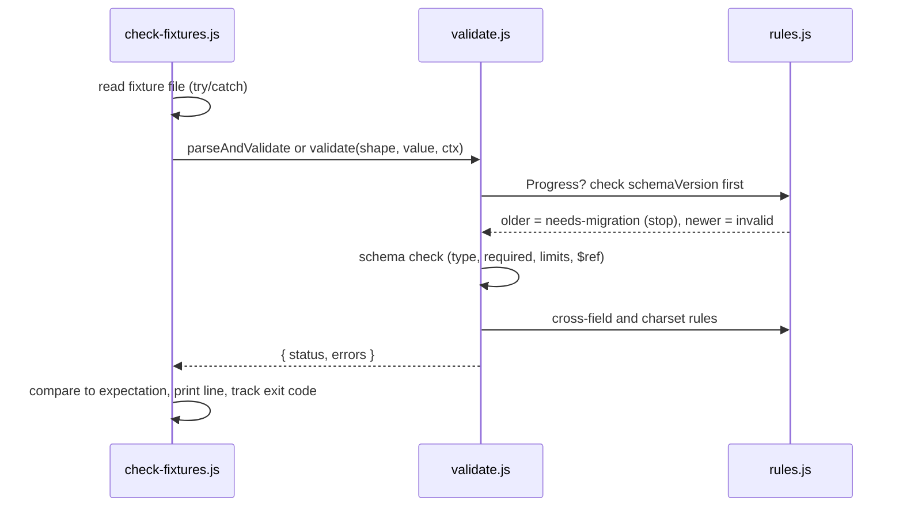

# Design: Block 1, data contract and fixtures

**Spec:** `contract`. **Implements:** `requirements.md` (approved by Shara Nov 11). **Status:** Approved by Shara Nov 11.

## Decision: hand-written validator, no library

The open decision from `docs/current-block.md`. We write a small validator that understands only the part of JSON Schema our 11 schemas use. No new dependency, so no longevity check and nothing extra to pin. If a schema uses a keyword the validator doesn't know, it throws, so a rule can never be silently ignored.

## Files

| File | Job | Est. lines |
|---|---|---|
| `contract/schemas/*.json` (11) | One schema per G4 shape | 15 to 50 each |
| `contract/types.js` | JSDoc typedefs, one per shape, each linking its schema. `CURRENT_SCHEMA_VERSION = 1`. | ~70 |
| `contract/schemas.js` | Loads and vets the schemas once (the only `node:fs` code). Exports `loadSchemas()`. | ~55 |
| `contract/validate.js` | Schema-subset checker. Exports `validate(shape, value, ctx)` and `parseAndValidate(shape, text, ctx)`. | ~130 |
| `contract/rules.js` | Rules a schema can't express: misses vs attempts, charset checks, schema version. | ~80 |
| `fixtures/normal/*.json` | At least one valid fixture per shape | small |
| `fixtures/ugly/*.json` | The 11 G4 cases, plus optional boundary cases | small |
| `scripts/check-fixtures.js` | Runs every fixture, prints one line each, sets the exit code. Also exports `checkAll()` for the test. | ~70 |
| `contract/contract.test.js` | `node --test` entry: runs `checkAll()`, plus one property test | ~50 |
| `.kiro/hooks/fixture-check.json` | Hook H3 | ~12 |

`validate.js` and `rules.js` are added to the Block 1 allowlist by this design (one file, one responsibility; together they'd pass the 150-line soft cap). `structure.md` gets the same two names.

## Flow



## Fixture file format

Every fixture, normal or ugly, is a wrapper so it can state its own expectation:

```json
{
  "shape": "DrillResponse",
  "expect": "invalid",
  "reason": "line 2 has a character outside the pack charset",
  "pack": "pack.mini",
  "value": { "lines": ["fad sad"], "source": "ai" }
}
```

| Field | Rule |
|---|---|
| `shape` | One of the 11 shape names |
| `expect` | `valid`, `invalid`, or `needs-migration`. Normal fixtures are always `valid`. |
| `reason` | Required when `expect` is `invalid` |
| `pack` | Optional. Name of a pack fixture in `fixtures/normal/` whose charset is the context. |
| `value` or `raw` | Exactly one. `raw` is a string the checker runs through `JSON.parse` first. |
| `expectError` | Optional, invalid fixtures only. A phrase that must appear in at least one real error message, so a fixture can't pass for the wrong reason. |

**Why `raw`:** saved progress comes back from localStorage as a string, and AI drills come back as text, so "corrupted JSON" and "truncated mid-line" are really bad strings. Keeping them as strings inside valid fixture files also means Biome can lint every fixture without a config change. This closes the lint note in `requirements.md`.

File names: `<shape>.<case>.json`, e.g. `progress.zero-rounds.json`. The UI track reads `.value`.

## Validator: what the schema subset supports

`type` (one type or a list; names: `string`, `number`, `integer`, `boolean`, `object`, `array`, `null`), `required`, `properties`, `additionalProperties` (`false`, or a schema that every extra key's value must match, used for `Pack.pools`), `items`, `enum`, `const`, `minimum`, `maximum`, `minLength`, `maxLength`, `minItems`, `maxItems`, `$ref` (to another file in `schemas/`), `description` (ignored). Anything else throws when the schema loads. `$ref` is the bare file name of another schema in the same folder (`"$ref": "item.json"`). No `$schema` or `$id`.

String lengths count characters, not UTF-16 units (`[...s].length`), so `ñ` and `¿` count as one.

**Result:** `{ status: "valid" | "invalid" | "needs-migration", errors: [{ path, message }] }`. Messages are plain, e.g. `rounds: 201 items, max is 200`.

## Rules (`rules.js`)

| Rule | Req |
|---|---|
| Progress: `schemaVersion` checked before anything else. Lower than current returns `needs-migration`; higher returns `invalid`, "newer than this build." | 4.2, 4.3 |
| KeyStat: `misses` no more than `attempts`, wherever a KeyStat appears | 2.5 |
| Progress: one KeyStat per key, one GhostRun per mode and pack | 2.12 |
| Pack: every character of every item's `text` is in the pack's own `charset` | 3.1 |
| DrillRequest: every weak key is in `ctx.charset` | 3.2 |
| DrillResponse: every character of every line is in `ctx.charset`; one bad character rejects the whole response | 3.3 |

**Interface (confirmed Nov 11):**
- `checkVersion(shape, value)` returns `null` or `{ status: "needs-migration" | "invalid", errors }`. Runs before the schema check. Returns `null` for any shape other than Progress and for non-object values.
- `checkRules(shape, value, ctx)` returns an array of `{ path, message }`. Runs only after the schema check passes, so it can trust types.

`ctx` is `{ charset }`. A DrillRequest or DrillResponse checked with no charset is `invalid`, "no pack given," so a missing context can't pass by accident.

## Shape details G4 leaves open

Loosest fit now, owned later (Req 1.3). Each schema's `description` names the block.

| Field | Now | Defined in |
|---|---|---|
| Timestamps (`KeyStat.lastSeen`, `RoundResult.date`, `Progress.createdAt`) | epoch milliseconds, whole number | here |
| `Milestone.threshold` | number, or null when the milestone has none (lesson passed) | here |
| `Pack.pools` | object: any pool name, each an array of Item | here |
| `Pack.charset` | string of allowed characters (space included when used) | here |
| `Pack.version` | string | here |
| `Pack.lessons` | array of objects | Block 8 (lessons) |
| `Progress.keys` | array of KeyStat | here |
| `Progress.bests`, `Progress.settings` | object | Block 3, Block 6 |
| `Progress.lessonsPassed` | array of `{ lessonId, how }`, `how` is `lesson` or `testout` | here |
| `Progress.milestones` / `ghosts` | arrays of Milestone / GhostRun | here |
| `RoundResult.keyDeltas` | object | Block 2 (engine) |
| `RoundResult.drillSource` | `built-in`, `ai`, or null | here |
| `RoundResult.lessonId` | string or null | here |
| `RoundResult.cleared`, `wave` | whole numbers, 0 when the mode has none | here |
| `Keystroke.expected`, `typed` | one character each | here |
| `Diagnosis.weakKeys` | array of up to 6 one-character strings | here |
| `Diagnosis` sentence `severity`, `Milestone.kind` | string | Block 3, Block 11 |
| `DrillRequest.weakKeys` | array of up to 6 `{ key, rate }` | here |

## Error handling

- The checker reads each file in try/catch. A file that isn't JSON reports `invalid: not JSON`, and the run continues (Req 7.3).
- A schema with an unknown keyword is reported as a FAIL naming the schema, with exit 1. That's a bug in our files, not a crash.
- The checker never writes files and makes no network calls (Req 7.4).

## Testing

| Test | Named reason |
|---|---|
| `checkAll()` in `contract.test.js` | PASS line: every fixture matches its expectation |
| fast-check property: any DrillResponse line containing at least one character outside the charset is rejected | PRD G12: "validators letting an out-of-charset character through" |

Nothing else. Engine property tests start in Block 2.

## Hook H3

`.kiro/hooks/fixture-check.json`, same shape as `line-cap.json`: a command action running `node scripts/check-fixtures.js`, fired when the agent saves a file matching `contract/**` or `fixtures/**`. Kiro confirms the exact file-save trigger name against its hook schema before writing the file. Its description says it retires when the contract freezes after Block 3.

## Known limits (logged Nov 11)

- `validate.js` reads schemas with `node:fs`, so it runs in Node only (checker, tests, `api/`). Before the browser uses it (Block 4 storage, import validation), switch to static JSON imports (`import x from './schemas/item.json' with { type: 'json' }`), which both Node and Vite support. Note it in Block 4's spec.
- `const` and `enum` compare with `JSON.stringify`. Fine for the scalar and null values the schemas use.

