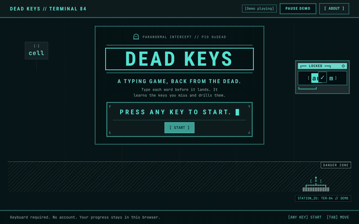

# Dead Keys

*A typing game, back from the dead.*

> I learned on a typewriter in middle school, and the Mac games at home helped me improve. In 2000, almost half of US high school grads took a typing class. By 2019 it was 2.5%. So I brought the games back.

The number: US high school graduates who earned keyboarding credit fell from 44.1% in 2000 to 2.5% in 2019 ([NCES, NAEP High School Transcript Study, Table 1](https://nces.ed.gov/nationsreportcard/hsts/2019_tables/2019_table1.aspx)).

**Play it:** [dead-keys.vercel.app](https://dead-keys.vercel.app)



Dead Keys rebuilds the 1980s typing games MasterType and Type Attack as a keyboard trainer that notices which keys you miss and drills them. Built with [Kiro](https://kiro.dev) for the [Kiroween Hackathon 2026](https://kiroween.devpost.com/), category Resurrection.

## Two resurrections

**MasterType (1981) and Type Attack (1982).** Words fall toward you, and you type them before they land. Dead Keys keeps that pressure and the arcade feel, with synthesized sound and a phosphor-terminal look. It changes what happens after the round: every key you miss is counted, and the game builds the next drill around those keys. No assets from either game are used.

**Office Keys (August 2025).** My first Lovable build, a no-login typing practice app for court staff. Dead Keys keeps its ideas (no accounts, practice the keys that trip you up) and none of its code.

## How to play

1. Press any key on the title screen, or watch the demo play itself.
2. Pick Play, a Daily drill, or a lesson. Choose English or Spanish words on Play.
3. Type each word before it lands. Every key you miss is remembered.
4. After the round, drill the keys you missed, race your own ghost, or share your card.

## How we count

WPM, accuracy and weak keys are explained in the game, on the **How we count** page (from the menu, or the link under your results). Short version: speed is correct characters divided by five, per minute, with pauses left out. Accuracy is right keystrokes over all keystrokes. A miss counts against the key you should have pressed. A personal best only counts at 90% accuracy or better.

## Architecture

```
Browser (static, on Vercel)                    Server (one Vercel function)
  index.html, styles, ES modules                 api/drill.js         POST only, same origin, under 2 KB
  engine/ (pure functions, no DOM)               api/_lib/limits.js   per-visitor limit + daily cap
  ui/ (DOM, textContent only)        POST        api/_lib/prompt.js   weak keys in, prompt out
  storage/ (localStorage, try/catch) ------->    api/_lib/bedrock.js  the only file that talks to AWS
                                     <-------    api/_lib/answer.js   every word checked before it leaves
                       { lines, source } or { error } -> built-in drill
```

The AI writes practice lines from your weak keys with Amazon Nova Micro on Amazon Bedrock. Everything else runs in your browser, and after one visit it installs as an app and plays offline. The service worker (`public/sw.js`) never touches the AI route. If the AI is off, capped, slow or wrong, you get the built-in drill and the game carries on.

**File map.** One file, one job. Source files stay under 150 lines and nothing goes over 250 (a Kiro hook checks).

| Folder | Job |
|---|---|
| `contract/` | The data shapes both halves agree on, and the validator. Frozen after Block 3. |
| `src/engine/` | Rounds, scoring, word timing. Pure functions, no DOM. |
| `src/drills/`, `src/lessons/` | Built-in drills, the daily drill, lessons. |
| `src/ghost/`, `src/attract/`, `src/specwave/` | Ghost race, the title demo, the easter egg. |
| `src/storage/`, `src/packs/` | Local saves and settings; word packs. |
| `src/ui/`, `src/render/`, `src/styles/` | Screens and components; the play field; CSS. |
| `src/sound/`, `src/share/`, `src/analytics/` | Synthesized sound; the share card; page-view counting. |
| `api/` | The AI drill route and its helpers. |
| `packs/` | English and Spanish word packs, their sources and blocklists. |
| `evals/` | The golden set: six weak-key profiles run through the real route. |
| `mcp/` | An MCP server so Kiro can validate packs and run the golden set. |

## Decision records

Short form: context, decision, why, trade-off.

| Decision | Why | Trade-off |
|---|---|---|
| **Contract first.** Shapes and fixtures (normal and ugly) before any screen. | Both halves build against the same thing, and a layout that survives the ugly fixtures is ready to wire. | Slower start. Changing a shape later costs a contract change. |
| **Local-only storage.** No accounts, progress in localStorage. | Nothing to breach, nothing to sign up for. | Progress lives in one browser. Backup and import in Settings cover moving it. |
| **Two-layer adaptive drills.** Built-in drills always work; AI drills sit on top. | The game never waits on a model. | Two drill paths to test. |
| **Nova Micro.** Lifecycle Active when checked Nov 7, 2026. | A low-cost Bedrock text model that does the job ($0.035 per 1M input tokens, $0.14 per 1M output, PRD G3). | Other Nova models went legacy in March 2026. Micro could too; the legacy period covers judging, and the fallback covers the rest. |
| **The model's words are checked, not trusted.** Each word must be pack letters, 2 to 12 long, a real English word (SCOWL en_US) and off the blocklist. | The model once wrote "zizz". Nothing it writes reaches you unless it passes. | Some good rare words get dropped too. |
| **Vercel function over Lambda.** | One deploy for site and route. AWS is reached through Vercel OIDC, so there are no AWS keys anywhere. | Tied to Vercel's function runtime. |
| **Vanilla JS with JSDoc.** | No framework to learn or update; types without a build step. | More DOM code by hand. |
| **Synthesized sound.** Web Audio recipes, no audio files. | No licensing questions, tiny download. | Sounds are simple by design. |
| **In-memory caps.** Rate limit and daily cap per function instance. | No database for a hackathon game. | Approximate: two warm instances each count separately. An AWS Budgets alert at $5 is the backstop. |
| **README Clew 2 visual system.** | Reused color and type tokens from my October 2026 build (disclosed below). | The look was decided early, not explored. |

## How it was built with Kiro

I direct and decide. Kiro builds, commits and deploys. Claude reviews and writes some blocks to save Kiro credits. The repo shows all of it.

**Steering files** (`.kiro/steering/`): `product.md`, `structure.md`, `tech.md` and `ponytail.md` load always. `a11y.md` loads only when a UI, render or style file is in play (`fileMatch`).

**Specs, one per block** (`.kiro/specs/<block>/`): requirements, design, tasks. Requirements are written in EARS. An example from `ai-drills`:

> WHEN AI drills are off, or there are no weak keys, THE browser SHALL make no request and run the built-in drill.

**Hooks** (`.kiro/hooks/`), each with a lifecycle:

| Hook | Trigger | Job | Lifecycle |
|---|---|---|---|
| `line-cap` | Agent stops | Warn at 150 lines, error at 250 | Permanent |
| `block-scope` | Session start | Print the current block, its file allowlist and PASS line | Permanent |
| `fixture-check` | File save | Check the contract fixtures | Retired Nov 11, 2026, when the contract froze |
| `pack-check` | File save in `packs/` | Run the pack validator | Retires when the packs freeze |

Hooks retire because a check that keeps firing after its job is done turns into noise, and noise gets ignored. A retired hook stays in the repo, switched off, with a note saying why.

**Ponytail** ([dietrichgebert/ponytail](https://github.com/dietrichgebert/ponytail), MIT) is a steering file used unchanged, with an attribution line.

**Custom agents** (`.kiro/agents/`): a reviewer and an a11y auditor, run at block gates.

**Vercel from the IDE.** Kiro deploys previews and production with the Vercel CLI. Production only goes out when I say so.

**MCP server** (`mcp/server.js`): two tools Kiro can call. `validate_pack` checks a word pack. `run_golden_set` runs the six-profile golden set against the real model, and only with `confirm: true`, because it costs money.

**Tests.**

| Kind | Tool | Runs |
|---|---|---|
| Unit and property tests (900+) | `node --test` with fast-check | Touched files while building; the full suite before each commit |
| End-to-end flows (about 100) | Playwright with axe | Before each deploy; zero serious or critical axe issues |
| Golden set | `node evals/run.js` | On prompt changes |
| Lint | Biome | Before each commit |

## Planning disclosure

Kiroween asks for prior work to be disclosed. In short: Office Keys (August 2025) and README Clew 2 (October 2026) came before, with no code reused (README Clew 2's design tokens are reused by decision). A throwaway feel test was made Oct 17, 2026, before the window; none of its code is here. The PRD, research, cover art and X image were made before the build and live in `docs/`. Full list: [`docs/prior-work.md`](docs/prior-work.md).

## Privacy

Same words as the game's Privacy page:

> Two things leave your browser. When AI drills are on, we send which keys you miss and your recent speed, nothing else, so the AI can write practice lines for you. You can turn AI drills off in Settings. We also count page visits with Vercel Web Analytics, which uses no cookies and can't identify you. Your typing is never part of it.

## Accessibility

Menus, settings, lesson instructions, results, progress, heat map summary, "How we count," and the share card are fully usable with a screen reader. Gameplay is visual. Practice mode with announcements is the accessible path to practice.

Keyboard first, every screen. Screen readers hear screen changes through a polite live region. Each screen names the browser tab. Spanish characters type with AltGr on Windows and Option on Mac. Motion and scanlines turn off with reduced motion. Sound is off until you turn it on. Every deploy runs axe on each screen. Dead Keys is for a QWERTY keyboard in this version.

## Credits and licenses

- Code: MIT ([LICENSE](LICENSE)).
- English words: [top-english-wordlists](https://github.com/david47k/top-english-wordlists), built from Google Books Ngrams, CC BY 3.0.
- Spanish words: [FrequencyWords](https://github.com/hermitdave/FrequencyWords), built from OpenSubtitles 2018, CC BY-SA 4.0. The Spanish pack is shared under the same license.
- Spelling list: SCOWL en_US by Kevin Atkinson, notice in `packs/source/scowl_COPYRIGHT.txt`.
- Fonts: JetBrains Mono and Roboto Condensed, SIL Open Font License.
- Research: NCES, NAEP High School Transcript Study. More in [`docs/research.md`](docs/research.md).
- MCP server: [Model Context Protocol TypeScript SDK](https://github.com/modelcontextprotocol/typescript-sdk), MIT.
- Inspiration: MasterType (Lightning Software, 1981), Type Attack (Sirius Software, 1982), Office Keys.

## Run it locally

Needs Node 22.12 or newer.

```
npm ci
npm run dev          # http://localhost:5173
npm test             # unit tests
npm run test:e2e     # Playwright flows
npm run lint
```

Locally the AI route has no AWS access, so drills use the built-in layer. That's the fallback working, not a bug.

---

By [L. Cordero](https://clewlabs.org).

AI Assisted. Human Approved. Powered by NLP.
